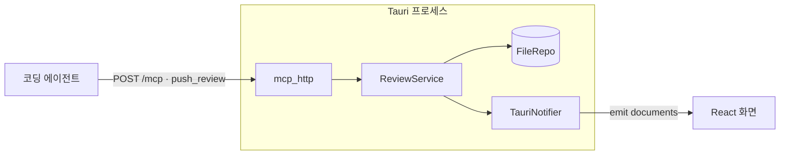

# Sidecar Review

코딩 에이전트가 세션 중에 바꾼 핵심 코드를 MCP로 보내면 데스크탑 앱에 바로 뜬다. 세션 하나가 문서 하나다.



MCP 서버는 앱 프로세스 안에서 `127.0.0.1:7437`로 돈다. 앱이 켜져 있어야 에이전트가 붙는다.

## 실행

```sh
pnpm install
pnpm tauri dev
```

## 에이전트 연결

```sh
claude mcp add --transport http sidecar http://127.0.0.1:7437/mcp
```

도구는 `push_review` 하나다. `agent`, `cwd`, `agent_session_id`를 함께 보내면 세션 목록의 ⓘ 아이콘에 나온다. `session`이 같으면 `blocks`가 그 문서 뒤에 이어 붙는다.

| type | 필드 | 화면 |
|---|---|---|
| `diff` | `file`, `before`, `after`, `mermaid` | CodeMirror unified diff, 안 바뀐 줄은 접힘 |
| `code` | `file`, `code`, `mermaid` | CodeMirror 읽기 전용 |
| `mermaid` | `source` | Mermaid 다이어그램 |
| `html` | `html` | sandbox iframe (차트·다이어그램) |

모든 블록에 한 줄짜리 `title`을 붙일 수 있다. `diff`·`code` 블록의 `mermaid`는 그 코드를 설명하는 다이어그램이고 코드 위에 그려진다. 다이어그램 없이도 명백한 코드에서만 뺀다.

화면은 세션 목록 | 선택한 세션의 목표와 파일 목록 | 내용, 세 칸이다. 파일 목록에서 파일을 고르면 그 파일의 `diff`·`code` 블록만 남는다. diff는 기본이 inline이고 "diff 나란히 보기"를 켜면 side by side로 바뀐다.

```json
{
  "session": "feat/login-retry",
  "goal": "로그인 실패 시 재시도 횟수 제한",
  "blocks": [
    { "type": "diff", "title": "실패 횟수 확인 추가", "file": "src/auth.ts", "before": "return verify(user, pw);", "after": "if (user.tries > 5) throw new Locked();\nreturn verify(user, pw);" }
  ]
}
```

## 구조

Rust (`src-tauri/src`, hexagonal)

- `domain.rs` — `Document`, `Block`
- `application.rs` — `ReviewService`와 포트(`DocumentRepository`, `DocumentNotifier`)
- `adapters/` — `mcp_http`(inbound), `tauri_ui`(inbound command + outbound emit), `file_repo`(outbound, 앱 데이터 폴더의 `documents.json`)
- `lib.rs` — 조립

React (`src`, Feature-Sliced Design)

- `app` → `pages/review` → `widgets/{session-list,file-list,document-view}` → `entities/document` → `shared/ui`

## 테스트

```sh
cd src-tauri && cargo test
```
